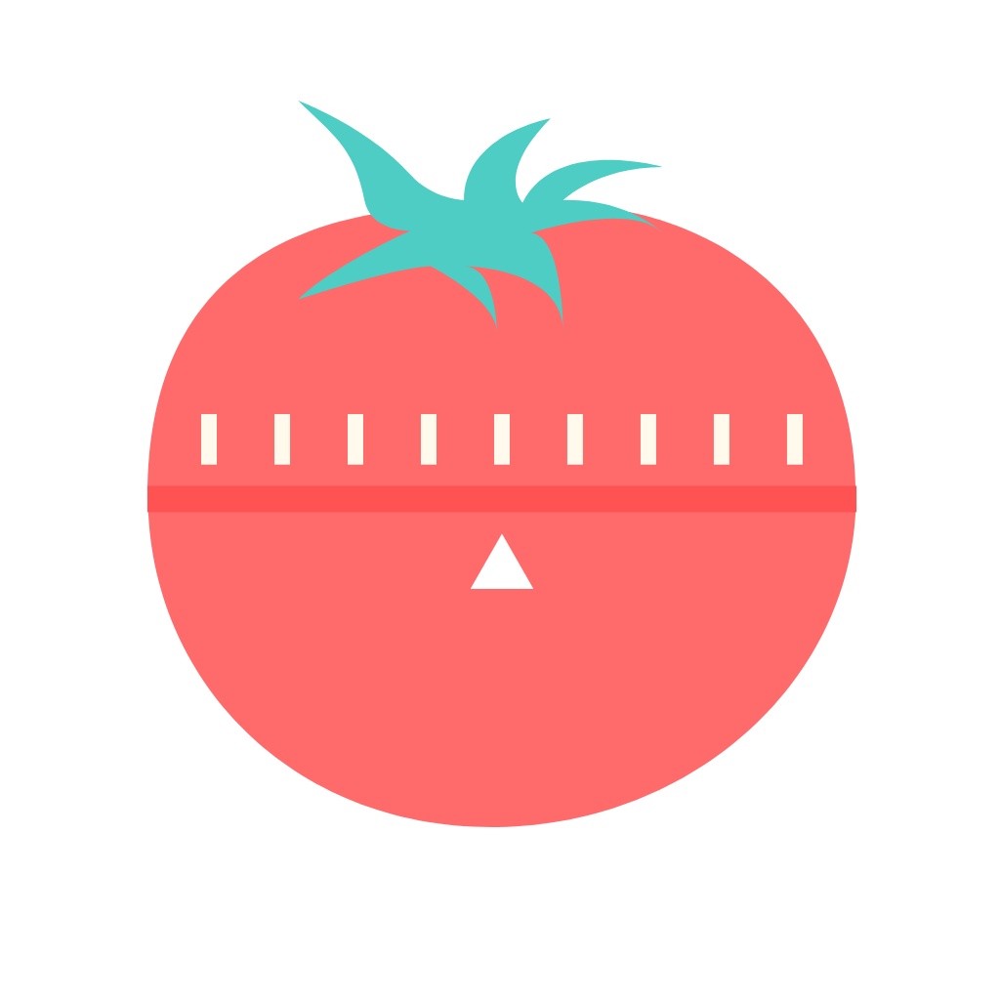
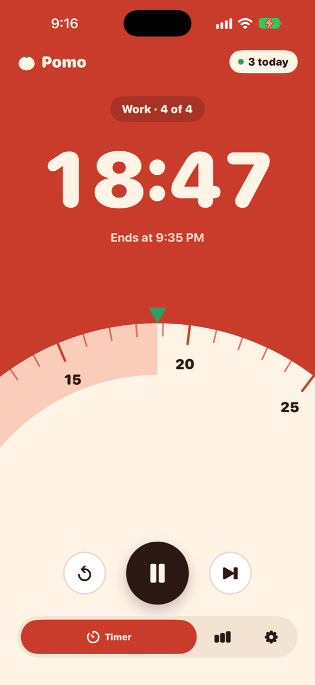
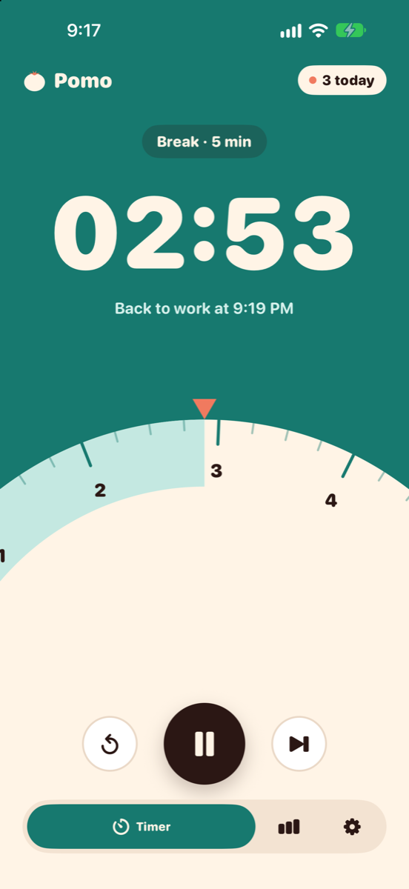
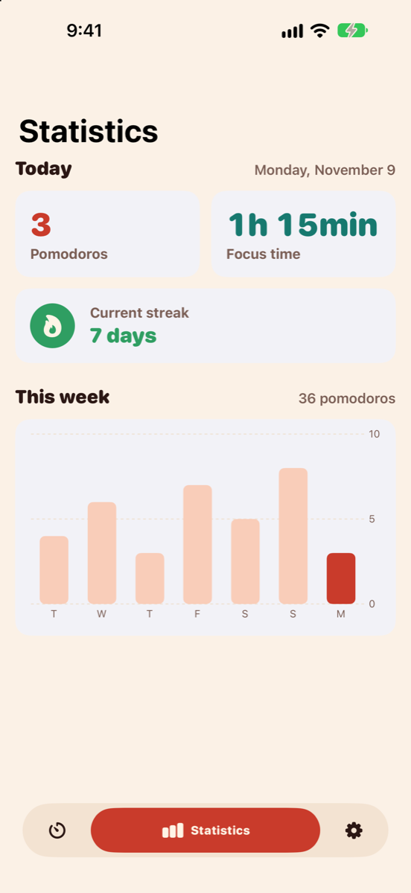
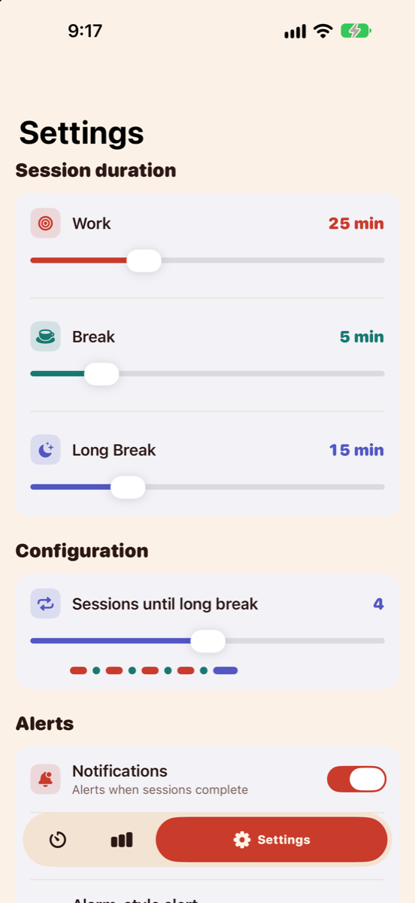
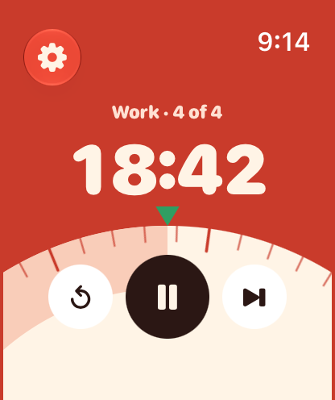
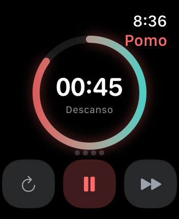
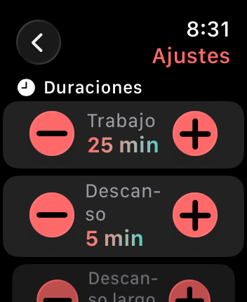
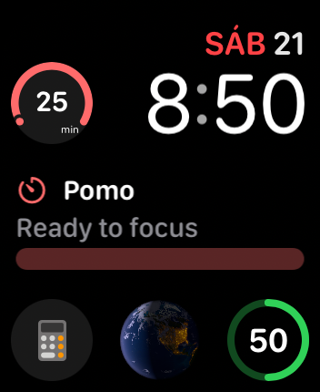

<p align="center">
  
</p>

<h1 align="center">Pomo — Pomodoro Timer</h1>

<p align="center">
  A kitchen-timer Pomodoro app for iPhone, iPhone Duo and Apple Watch: a cream dial that turns as you focus, Live Activities and Dynamic Island controls, Siri and Control Center, statistics, and bidirectional Watch sync.
</p>

<p align="center">
  
  
  
  
</p>

## Screenshots

### iPhone

<p align="center">
  
  &nbsp;&nbsp;
  
  &nbsp;&nbsp;
  
  &nbsp;&nbsp;
  
</p>

### Apple Watch

<p align="center">
  
  &nbsp;&nbsp;
  
  &nbsp;&nbsp;
  
  &nbsp;&nbsp;
  
</p>

## Features

### Timer
- **Kitchen dial** — the session color fills the screen and a cream dial turns as time passes, with the minutes left painted on it
- **Focus, short and long breaks** — each with its own color; cycle dots toward the long break
- **Reliable in the background** — time is stored as end dates, so it stays right if the app is suspended or closed; sessions that end while closed are still recorded
- **Alerts** — Time Sensitive notification, or an optional alarm-style alert with AlarmKit (iOS 26+) that rings in silent mode and Focus

### Live Activities & Dynamic Island
- Pause, resume, skip and reset from the Lock Screen and the Dynamic Island, even with the app closed (App Intents run in the app's process)
- Live ring and countdown without app updates; "Session complete" with a Next button when a session ends in the background
- Narrow island support (`isDynamicIslandLimitedInWidth`): iPhone Duo's vertical island, landscape, several activities
- Apple Watch Smart Stack layout

### Apple Watch
- Independent timer with its own alert, bidirectional sync with iPhone (newest change wins, no duplicate statistics)
- Complications that count down live

### Across the system
- **Siri, Shortcuts, Spotlight, Action button** — start focus, start a break, pause, resume, time remaining (English and Spanish phrases)
- **Control Center / Lock Screen control** (iOS 18) and a **Today widget** for Home Screen, Lock Screen and StandBy

### iPhone Duo
- Outer screen: sections move to a vertical toolbar in the side sensor-bar strip
- Inner screen: split exactly at the hinge reported by the system — timer | today's stats when open like a book, timer on top and controls below in laptop posture

### Statistics
- Today's pomodoros, focus time, daily streak and a 7-day chart, stored with SwiftData

## Architecture

### Built With
- **Swift 5** & **SwiftUI** — Declarative UI
- **SwiftData** — Session persistence
- **Combine** — Reactive state management
- **ActivityKit** — Dynamic Island & Live Activities
- **WatchConnectivity** — iPhone ↔ Watch sync
- **WidgetKit** — Watch complications
- **Charts** — Native chart visualization
- **AVFoundation** — Audio alerts

### Project Structure
```
Pomo/
├── Core/
│   ├── Models/           # TimerSession, TimerType
│   ├── ViewModels/       # TimerViewModel, StatsViewModel
│   ├── Services/         # DataService, NotificationService
│   └── Features/         # Feature-specific views
├── Shared/
│   ├── Extensions/       # SwiftUI extensions
│   ├── Connectivity/     # WatchConnectivity managers
│   └── Utils/            # Constants and utilities
├── Resources/            # Assets, localizations
├── PomoWatch/            # Apple Watch companion app
├── PomoWatchWidgetExtension/  # Watch complications
└── PomoWidgetExtension/  # Dynamic Island & Live Activities
```

### Pattern
- **MVVM** — Clean separation of concerns
- **Service Layer** — Dedicated services for data, notifications, audio, and connectivity
- **App Groups** — Shared state between iPhone, Watch, and widget extensions

## Getting Started

### Requirements
- **iOS 18.0+** / **watchOS 11.0+** (AlarmKit alerts on iOS 26+, iPhone Duo hinge layouts on iOS 27.1+)
- **Xcode 27+**
- **Swift 5.0+**

### Installation
```bash
git clone https://github.com/arzaluz-chris/pomo.git
cd pomo
open Pomo.xcodeproj
```

Build and run with `Cmd + R`. For the Watch app, select the PomoWatch scheme.

### Default Configuration
| Setting | Default |
|---------|---------|
| Work session | 25 min |
| Short break | 5 min |
| Long break | 15 min |
| Sessions until long break | 4 |

All settings can be customized in the Settings tab and sync to Apple Watch.

## Localization

- **English**
- **Spanish**

Uses Xcode String Catalogs for easy extension to additional languages.

## Privacy

All data is stored locally on device. No accounts, no analytics, no third-party services. iPhone–Watch sync is local via App Groups and WatchConnectivity.

## License

This project is available under the MIT License.

## Contact

Created by [Christian Arzaluz](mailto:christian.arzaluz@gmail.com)

[Website](https://chrisarzaluz.dev/pomo/) · [Privacy Policy](https://chrisarzaluz.dev/pomo/privacy.html) · [Support](https://chrisarzaluz.dev/pomo/support.html)
